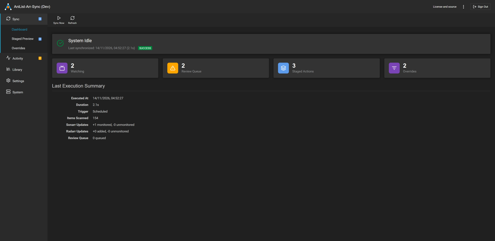
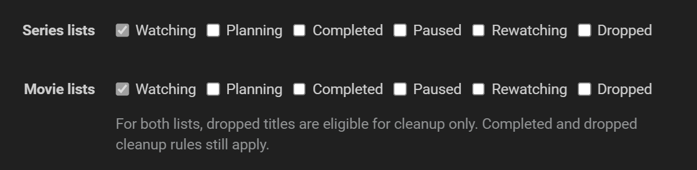
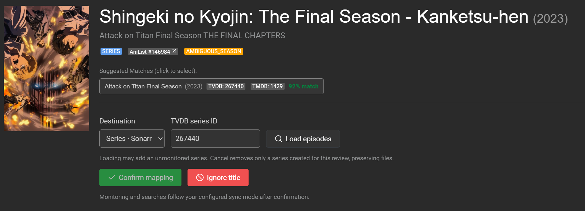
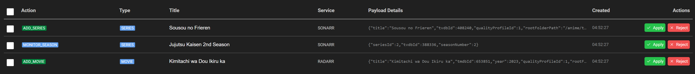
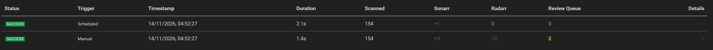

# AniList-Arr-Sync

[](https://github.com/lucasskywalker64/anilist-arr-sync/releases/latest)    [](https://github.com/lucasskywalker64/anilist-arr-sync/actions/workflows/ci.yml?query=branch%3Amain+event%3Apush)    [](LICENSE)    [](#install-and-run)

**Keep your anime library in sync with AniList.**

AniList-Arr-Sync connects your AniList lists to Sonarr and Radarr, so you can manage
what you want to watch without adding every title by hand. Choose which list
statuses to follow, then synchronize manually or on a schedule.

A web dashboard helps you review matches, resolve ambiguous titles, and preview
changes before applying them. Anime series go to Sonarr, movies go to Radarr,
and your existing download and library settings stay under your control.

[Download](https://github.com/lucasskywalker64/anilist-arr-sync/releases)
| [Installation](#install-and-run)
| [Features](#features)
| [Report a problem](https://github.com/lucasskywalker64/anilist-arr-sync/issues)

[](.github/images/dashboard.png)

Screenshots show sample data. Open any image to view it at full resolution.

## Features

### Follow the lists you choose

Choose which AniList statuses to follow, such as Watching or Planning, with
separate selections for series and movies. Match your Sonarr and Radarr libraries
to the lists you actually use.

[](.github/images/selected-lists.png)

### Resolve uncertain matches

Review titles that need a closer look, compare suggested matches, and confirm
the right series, movie, or season. Save manual overrides for future syncs, or
ignore a title you do not want to import.

[](.github/images/resolve-match.png)

### Preview changes before applying them

Use a dry run to inspect proposed additions and monitoring changes before sending
them to Sonarr or Radarr. The staged preview lets you apply or reject individual
actions. The first synchronization defaults to a dry run.

[](.github/images/staged-changes.png)

### Keep synchronization running automatically

Set a synchronization schedule and check the history to see when each run
finished, how many titles it scanned, and what changed in Sonarr and Radarr.
You can also start a sync manually whenever you need one.

[](.github/images/sync-history.png)

Local backups, Discord notifications, and custom webhooks help you keep track of
your installation. Run the app directly, as a Windows service, in the Windows tray,
or in a container.

## Getting started

You need your AniList username and an existing Sonarr or Radarr installation for
the types of anime you want to manage. Have its URL and API key ready for setup.
Sonarr and Radarr continue to manage downloads and media files through their own
settings.

Choose an installation method below, open the dashboard, and follow the setup
wizard to connect your services. Review your first dry run before applying
changes. Prebuilt downloads do not require Go, Node.js, or other developer tools.

## Install and run

Choose the native architecture for your machine from [GitHub Releases](https://github.com/lucasskywalker64/anilist-arr-sync/releases).

| Installation      | Supported targets                      | How to run                                       |
| ----------------- | -------------------------------------- | ------------------------------------------------ |
| Portable archive  | Linux amd64/arm64, Windows amd64/arm64 | Extract the executable and run it directly.      |
| Windows installer | Windows amd64/arm64                    | Choose Windows service or desktop tray mode.     |
| Container         | Linux amd64/arm64                      | Persist application data at `/config`.         |
| Package manager   | Scoop, AUR, WinGet, Chocolatey         | Install and update through the selected manager. |

Verify direct downloads using the [code signing policy](CODE_SIGNING.md).
Package-manager catalog acceptance and availability are controlled by each
repository; check the selected manager's listing.

### Portable executable

On Windows, extract the ZIP and start the executable from PowerShell:

```powershell
.\anilist-arr-sync.exe --bind-address 127.0.0.1
```

On Linux, extract the archive and run:

```sh
./anilist-arr-sync --bind-address 127.0.0.1
```

Open `http://localhost:7171`. Complete the administrator and service setup,
configure the AniList username and at least one Sonarr or Radarr connection, then
select its quality profile and root folder. Review the first dry-run results
before applying changes.

These commands bind to localhost. The configuration default is `0.0.0.0`, with
Forms authentication and authentication bypass for configured local networks.
Configure authentication, TLS or a trusted reverse proxy, and network access
before making the dashboard available remotely.

### Windows installer

The installer requires administrator privileges. Service mode starts the
application with Windows. Desktop mode starts the tray application at sign-in;
the signed-in desktop account must itself be an administrator. Desktop
installation rejects elevation using a different administrator's account.
Double-click the tray icon to open the dashboard, or use its right-click menu to
open the dashboard or quit.

Both modes retain data in `%ProgramData%\AniList-Arr-Sync` by default. Upgrades
preserve the data location and package-manager ownership. Use Windows Installed
Apps or the generated uninstaller to remove an installer-based installation.
Uninstalling preserves user data.

### Container

```sh
docker run --detach --name anilist-arr-sync \
  --publish 127.0.0.1:7171:7171 \
  --volume anilist-arr-sync:/config \
  ghcr.io/lucasskywalker64/anilist-arr-sync:latest
```

Or save this as `compose.yaml` and run `docker compose up -d`:

```yaml
services:
  anilist-arr-sync:
    image: ghcr.io/lucasskywalker64/anilist-arr-sync:latest
    restart: unless-stopped
    ports:
      - "127.0.0.1:7171:7171"
    volumes:
      - anilist-arr-sync:/config

volumes:
  anilist-arr-sync:
```

The image runs as uid 65532. Named volumes retain configuration, database, and
backups; bind mounts must allow that uid to write to `/config`. Replace the
container image to update. Use `:develop` to select nightly builds, or a version
tag to pin a stable release. Stop and remove the container to uninstall it;
remove its persistent volume separately only when you intend to delete its data.

For a portable installation, stop the application and delete its executable to
remove the program. Uninstall managed installations through their package manager.
Deleting the executable does not delete configuration, database, or backups.

## Runtime and data

| Option                         | Purpose                                                                           |
| ------------------------------ | --------------------------------------------------------------------------------- |
| `--config`                   | Choose the configuration file.                                                    |
| `--data-dir`                 | Choose persistent application storage.                                            |
| `--port`, `--bind-address` | Override the listener for this process without saving those overrides.            |
| `--sync`                     | Run one synchronization, print a summary, and exit.                               |
| `--no-browser`               | Suppress automatic browser launch.                                                |
| `--tray`                     | Run with a Windows notification-area icon.                                        |
| `--version`                  | Print build version and commit.                                                   |
| `--license`                  | Print the license, dependency notices, and source links without starting the app. |

`--sync` exits with code 0 on success and 1 on error.

Environment overrides use `ANILIST_SYNC__[NAMESPACE]__[KEY]`. Common examples:

| Variable                                                           | Purpose                                                               |
| ------------------------------------------------------------------ | --------------------------------------------------------------------- |
| `ANILIST_SYNC__SERVER__BINDADDRESS`                              | Listener address, for example `0.0.0.0`.                            |
| `ANILIST_SYNC__SERVER__PORT`                                     | HTTP port, for example `7171`.                                      |
| `ANILIST_SYNC__SERVER__URLBASE`                                  | Reverse-proxy subpath, for example `/anilist-sync`.                 |
| `ANILIST_SYNC__SERVER__ENABLESSL`                                | Enable the application's HTTPS listener with `true`.                |
| `ANILIST_SYNC__SERVER__SSLPORT`                                  | HTTPS listener port; must differ from the HTTP port.                  |
| `ANILIST_SYNC__SERVER__SSLCERTPATH`                              | Path to the TLS certificate inside the application host or container. |
| `ANILIST_SYNC__SERVER__SSLKEYPATH`                               | Path to the TLS private key inside the application host or container. |
| `ANILIST_SYNC__ANILIST__USERNAME`                                | AniList username to synchronize.                                      |
| `ANILIST_SYNC__SONARR__URL`, `ANILIST_SYNC__RADARR__URL`       | Sonarr and Radarr base URLs.                                          |
| `ANILIST_SYNC__SONARR__APIKEY`, `ANILIST_SYNC__RADARR__APIKEY` | Credentials for the respective service.                               |
| `ANILIST_SYNC__LOG__LEVEL`                                       | Application log level, for example `Info`.                          |

The [environment parser](internal/config/env.go) lists all supported overrides.
At startup, environment values override `config.xml`; explicit `--port` and
`--bind-address` flags override the effective listener values for that process.
Change the environment in your service or Compose configuration and restart the
process or recreate the container to apply it. Environment overrides are reapplied
when configuration loads, so change them at their source rather than relying on
dashboard edits to override them.

Set **URL Base** under Settings > General for a reverse-proxy subpath. The advanced
**Enable SSL** and **SSL Port** settings control the application's HTTPS listener;
provide certificate and private-key paths through `SslCertPath` and `SslKeyPath`
in `config.xml`, or the environment variables above. The corresponding XML fields
are `UrlBase`, `EnableSsl`, and `SslPort`. Restart after listener changes.
When a reverse proxy terminates TLS, configure its certificate at the proxy.

Default data locations are:

- Containers: `/config`.
- Windows: `%ProgramData%\AniList-Arr-Sync`, falling back to
  `%APPDATA%\AniList-Arr-Sync` for a directly launched process when necessary.
- Linux and other direct launches: `$XDG_CONFIG_HOME/anilist-arr-sync`, or
  `~/.config/anilist-arr-sync` when `XDG_CONFIG_HOME` is unset.

Startup creates configuration and an API key when missing. Relative database and
backup paths resolve under the data directory. The scheduler stays idle until
AniList and at least one Servarr connection are configured. Backups follow the
configured retention policy. Restart after changing settings that the dashboard
marks as requiring a restart.

The header actions menu provides Restart, Shutdown, and Keyboard Shortcuts.
Restart reloads configuration and reconstructs the runtime in the same process.
Browser sessions survive regular restarts; process restarts, protocol changes,
and database changes require signing in again. Shutdown is disabled in containers.
SIGINT and SIGTERM request graceful shutdown with a 15-second deadline.

When changing from HTTPS to HTTP, a temporary status listener on the old HTTPS
address allows the dashboard to reconnect to the new instance. It expires after
one minute. The overlay offers a manual reconnect link if automatic reconnection
fails. Browser HTTPS enforcement and reverse-proxy routing still apply.

See the [privacy policy](PRIVACY.md) for stored data and external requests. Stop
the application before removing its data directory, backups, or storage paths
configured outside that directory.

## Releases and updates

| Channel | Identity and signing                                                                                       |
| ------- | ---------------------------------------------------------------------------------------------------------- |
| Stable  | Semantic version from `main`; Windows executables require approved, timestamped Authenticode signatures. |
| Nightly | Distinct version and exact `develop` commit; Windows executables omit Authenticode signing.              |

Both channels require final SHA256 checksums and a Minisign signature of
`checksums.txt`. The [code signing policy](CODE_SIGNING.md) defines verification
and signing requirements for each channel.

For SignPath Foundation-sponsored releases: Free code signing provided by
[SignPath.io](https://about.signpath.io/), certificate by
[SignPath Foundation](https://signpath.org/).

Direct downloads and direct installer installations use the built-in updater.
Stable is the default: `UpdateBranch=main`. Select `UpdateBranch=develop` to opt
into nightlies. Automatic updating is a separate setting and defaults to false.
Source builds require the trusted public-key build input to verify updates;
missing verification configuration blocks built-in updates.

Package recipes place an `update-owner` marker beside the real executable.
Managed installations update through Scoop, AUR, WinGet, or Chocolatey; containers
update through image replacement. Built-in executable replacement is disabled
for these installations. Installing directly over a managed installation preserves
its ownership. A directly launched process also needs permission to replace its
executable, which can require elevation under Program Files.

## Build and development

See [SOURCE.md](SOURCE.md) for source downloads, dependency sources, prerequisites,
and build instructions.

The frontend is embedded in the executable. Build it before compiling the Go
application so the executable includes the current dashboard.

With GNU Make installed, `make build` creates the application executable.
`make all` builds it and runs frontend tests, Go race tests, typechecking,
license-notice verification, and Go lint checks. See the
[Make targets and prerequisites](SOURCE.md#build-and-run-a-modified-version)
for individual checks and cleanup. The equivalent development checks can also
be run directly:

```sh
npm ci --prefix web
npm run check --prefix web
npm test --prefix web
npm run build --prefix web
python packaging/licenses.py --check
go build ./cmd/anilist-arr-sync
go test -race ./...
go vet ./...
go run github.com/golangci/golangci-lint/v2/cmd/golangci-lint@v2.14.0 run
```

The race detector requires a working CGO C compiler. Normal release executables
support builds with CGO disabled.

Release builds support `CGO_ENABLED=0` and embed their version, full commit, and
build date. The trusted Minisign public-key line is supplied with
`-X main.updatePublicKey=PUBLIC_KEY_LINE`; private signing material is not a build
input to the application.

## License and source

Copyright (C) 2026 AniList-Arr-Sync contributors. The project's original code is
licensed under the [GNU Affero General Public License, version 3 only](LICENSE),
SPDX identifier `AGPL-3.0-only`. This software comes with no warranty.
Third-party components retain the licenses and notices in
[THIRD_PARTY_NOTICES.txt](THIRD_PARTY_NOTICES.txt).

The application's **License and source** link and `anilist-arr-sync --license`
provide source for the exact build. [SOURCE.md](SOURCE.md) explains dependency
source, build instructions, and requirements for modified hosted versions.
